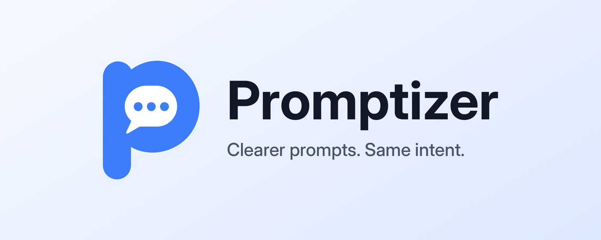

<div align="center">


# Promptizer

**Clearer prompts. Same intent.**

Promptizer rewrites the prompt you are already typing into one clean, professional paragraph —
on-device first, always as an editable preview, never auto-submitted.

[](LICENSE)
[](https://developer.chrome.com/docs/ai/built-in)
[](https://developer.chrome.com/docs/extensions/develop/migrate)
[](https://go.dev)
[](https://wxt.dev)



</div>

---

## What it does

You type a rushed prompt into ChatGPT or Claude. Press <kbd>⌘</kbd><kbd>⇧</kbd><kbd>Y</kbd>
(<kbd>Ctrl</kbd><kbd>Shift</kbd><kbd>Y</kbd>). Promptizer shows a rewritten version next to the composer.
Keep it, or dismiss it. Your words, clarified — not reinterpreted.

```
before:  make contact button sticky but dont change existing design

after:   Make the contact button sticky on scroll while preserving the
         existing design, spacing, and styling of the current layout.
```

## Why it is different

|                               |                                                                                                         |
| ----------------------------- | ------------------------------------------------------------------------------------------------------- |
| **On-device first**           | Chrome's built-in Gemini Nano runs the rewrite locally. Nothing leaves the machine in the default path. |
| **Preview, never submit**     | The rewrite lands in an editable preview. Promptizer never presses send for you.                        |
| **Intent preserved**          | Constraints, tone, and task stay. It cleans the wording, it does not invent requirements.               |
| **No telemetry**              | No prompt logging, no page scraping, no analytics.                                                      |
| **Zero runtime dependencies** | No Go modules beyond stdlib, no UI framework, no third-party runtime JavaScript.                        |

## How it works

```
  ChatGPT / Claude composer
            |
            |  Command+Shift+Y
            v
  +---------------------+        on-device, default path
  |  content script     | -----> Gemini Nano (Chrome built-in AI)
  |  editable preview   |
  +---------------------+ --+
            ^               |    fallback, opt-in and disclosed
            |               +--> 127.0.0.1:8765  ->  promptrefine serve  ->  Groq
            |
       Replace / Dismiss
```

Nano handles the rewrite locally. If Nano is unavailable on the device — or you pick Groq-only mode —
the extension calls a **local, token-authenticated** service on `127.0.0.1` that you run yourself.
No hosted backend exists.

## Install

Requirements: Chrome 138+, Node.js, [pnpm](https://pnpm.io) 10, Go 1.26+, `jq`.

```bash
pnpm install
make build-ext            # -> .output/chrome-mv3/
```

1. Open `chrome://extensions` → enable **Developer mode** → **Load unpacked** → select `.output/chrome-mv3/`.
2. Open Promptizer settings from the toolbar → **Check or download Gemini Nano** → wait for **Ready on this device**.
3. On ChatGPT or Claude, type at least 8 characters, press <kbd>⌘</kbd><kbd>⇧</kbd><kbd>Y</kbd>, then **Replace** or **Dismiss**.

> The hand-rolled build in `extension/` is the previous generation and still loads unpacked. New work goes to `src/`.

## CLI

`promptrefine` refines a prompt from stdin, so prompts never land in shell history.

```bash
make build                                 # -> ./bin/promptrefine
set -a; . ./.env; set +a                   # Groq key, copy from .env.example

printf '%s\n' 'make contact button sticky but dont change existing design' \
  | ./bin/promptrefine refine
```

Add `--json` for structured output, `--context-file ./context.txt` to pass extra context.

## Groq fallback (optional)

Two terminals:

```bash
set -a; . ./.env; set +a
./bin/promptrefine pair      # paste the printed token into extension settings
```

```bash
export PROMPTREFINE_EXTENSION_ORIGIN='chrome-extension://YOUR_EXTENSION_ID'
./bin/promptrefine serve
./bin/promptrefine health    # third terminal, sanity check
```

## Development

```bash
pnpm dev              # WXT dev server with hot reload
make verify           # go tests + race + vitest + typecheck + prettier + eslint + builds
make format           # prettier --write
./scripts/test-mock.sh  # loopback mock Groq, no external traffic
```

Always pnpm — never `npm install`, never `npx`. Full working rules in [AGENTS.md](AGENTS.md).

## Privacy

Only the prompt and context you explicitly select are processed. Gemini Nano keeps them on-device.
They reach Groq only in Groq-only mode or through the disclosed fallback, via a service running on your
own machine. No prompt logging, no page scraping, no automatic submission.

Details: [security and privacy](docs/security-privacy.md).

## Documentation

[Scope](docs/scope.md) · [Request limits](docs/request-limits.md) · [Troubleshooting](docs/troubleshooting.md) ·
[Known limitations](docs/known-limitations.md) · [Manual test checklist](docs/manual-test.md) ·
[Benchmarks](docs/benchmarks.md) · [Model evaluation](docs/model-evaluation.md) · [Contributing rules](AGENTS.md)

## Contributing

One change per branch and pull request. Run `make verify` before opening it. Ask before adding a
dependency, renaming files, or touching global configuration.

## License

[MIT](LICENSE) © PhongLee1210
